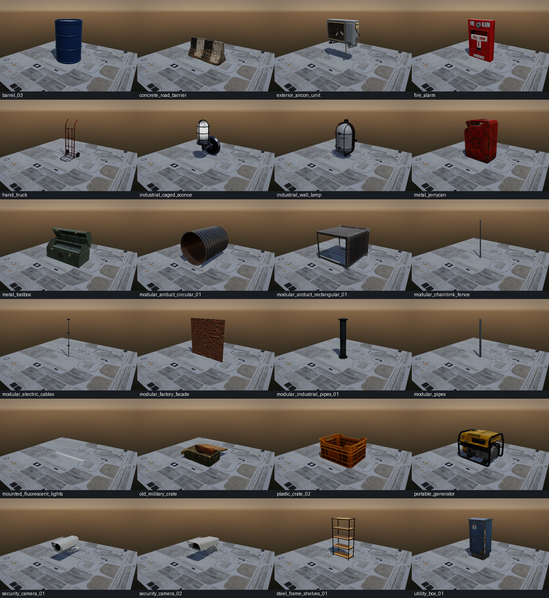
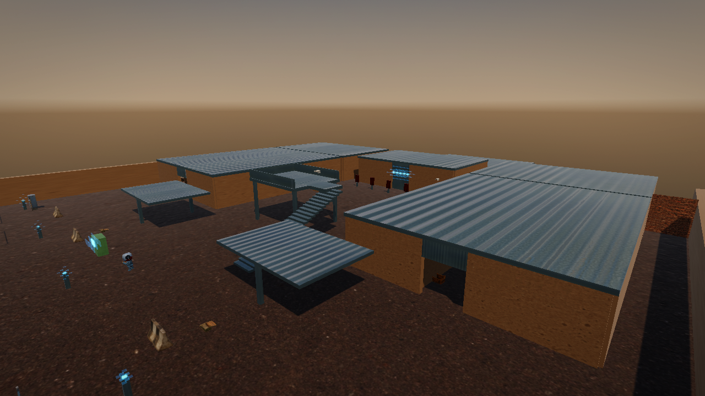

# Asset and renderer stabilization

This checkpoint starts from `prototype` commit `5ea918b`. It repairs delivery and
validation of the existing visual pass; it does not implement a new human player,
terrain, vegetation, serialization or an editor.

## Root causes and changes

1. The fetcher discarded glTF-relative include paths. Files required under
   `textures/` were downloaded beside the glTF instead. Fetching now preserves and
   validates every referenced buffer/image path before publishing a cook manifest.
2. Acquisition used mutable API/mirror state. The repository now carries locks for
   24 Poly Haven packages (163 source files) and 15 authored PBR maps. Normal fetches
   use pinned URLs, sizes and SHA-256 hashes; partial downloads are atomic and
   cached files are verified. Source updates require an explicit lock refresh.
3. Missing models were silently skipped. The full visual profile now requires its
   assets. Runtime startup logs a presence check, then AssetManager decodes the
   actual models. Build staging verifies a receipt produced only after cooking and
   decoding each output, including hashes tied to the source/recipe lock.
4. Ogre validates new GLSL programs before HLMS applies texture registers. OpenGL
   initially assigns all sampler uniforms to unit zero, producing premature
   mixed-sampler validation failures. A build-generated translation unit gives
   HLMS programs distinct initial sampler units before that validation. Normal
   Ogre binding still applies the real registers before drawing. Validation is
   retained, including a native negative control that deliberately creates a real
   collision and verifies that it is rejected. Custom legacy shader defaults are
   unchanged. The Ogre submodule and its pin are not modified.
5. File textures used a Windows-only WIC implementation. Loading now uses Ogre's
   registered image codecs and the existing engine texture upload API on all
   platforms, with sRGB/linear selection, mipmaps and neutral grayscale conversion.
6. Several downloaded models are catalogs of modular parts or alternate variants.
   The cook recipes now select explicit static nodes/subtrees or sibling sets and
   prune unused materials/textures. Bind transforms remain intact. Prop placement
   measures rest-pose bounds once per immutable model, preserves aspect ratio,
   bottom-centres the visual, and gives its collision proxy the same offset/scale.
7. Industrial practical lights now belong to World entities. Redeployment releases
   them along with imported handles, procedural fence geometry and cached bounds.
   Regression checks include zero remaining render objects and lights.

The high-fidelity crate and generator are cooked into `TPS/AAA/`, preserving the
original three checked-in TPS models. Therefore the full model count is **27**,
not the previous 25. The original source downloads are unchanged.

The provider's chain-link glTF uses a JPEG without opacity data for its wire card.
The level uses its authored post plus opaque procedural wire geometry. This does
not add general alpha blending, glass transmission or masked-material support.

## Windows workflow

From a VS2022 Developer Command Prompt:

```bat
git pull --ff-only --no-recurse-submodules origin prototype
GenerateProjects.bat
BuildAAAAssets.bat
msbuild Build\Generated\PlagC.sln /m /t:Sandbox /p:Configuration=Release /p:Platform=x64
```

The cooker is built incrementally even when an older EXE already exists. Fetch,
cook, decode or staging failures stop the workflow. `RuntimeAssets` runs for
Sandbox solution builds even when no C++ source changed. It stages only runtime
folders and required Ogre media; raw glTF sources stay out of the output folder.
The same process stages Debug and Dist when those configurations are built.

Launch from the configuration output folder. VS uses that working directory.
Dist retains the Windows subsystem; diagnostics are written to `Logs/PlagC.log`.
Existing Release/Dist `/O2` settings and static OpenAL configuration are preserved.

The source model downloads total about 89 MiB, plus the PBR maps. Cooked textures
are currently uncompressed, so allow roughly 0.7 GiB of runtime models **per build
configuration**. This checkpoint does not claim a Vega 7 frame-rate target.

## Linux and reproducibility

After generating/building the native projects:

```sh
bash BuildAAAAssets.sh
# Or supply an already-built cooker explicitly:
python Scripts/BuildAAAAssets.py --cooker Bin/linux-x86_64/Dist/AssetCooker
# Verify and recook from cached source files without network access:
python Scripts/BuildAAAAssets.py --cooker Bin/linux-x86_64/Dist/AssetCooker --offline
```

`--asset security_camera_01` builds the single-prop slice. `--output PATH` stages
an explicit output folder after a complete pack build. `StageRuntimeAssets.py`
defaults to the strict visual profile. Its explicit `base` and `inspection`
profiles are for standalone regression fixtures, not silent game fallbacks.

Maintainers update `Scripts/AAAAssetCatalog.py` for node/variant recipes. To select
new source revisions, run `FetchAAAWorld.py --refresh-lock --resolution 1k`, review
the resulting lock diff, recook and repeat native inspection. Normal generation
and fetches do not refresh those pins.

## Validation and evidence

* All 24 packages downloaded and their 163 dependencies passed checksum checks.
* All 24 cooked models were decoded again by `AssetCooker --inspect`.
* All 15 authored PBR maps passed their pinned SHA-256 checks.
* Debug, Release and Dist runtime folders passed receipt/hash preflight.
* Six offline acquisition tests and seven staging tests passed, including
  flattened dependencies, corrupt caches, stale receipts, source/output overlap,
  missing outputs and same-size/same-timestamp edits.
* Static-node tests cover selection, bind transforms, resource pruning/sharing
  and invalid or animated selection.
* 28 gameplay checks passed in both base and full visual profiles, including
  traversal, aiming, reload, death, redeployment and graphics/light cleanup.
* All 24 models rendered individually using real Mesa/EGL OpenGL. The isolated
  fixture covers authored texture decoding, PBR/IBL, HDR/sky, resize, draw-state
  validation, deliberate invalid sampler bindings, and resource cleanup.
* The full visual profile rendered and resized successfully, with the real
  `PC_TPS_VISUAL_MAX` path enabled and no sampler validation messages.
* VS2022 generation was inspected for the generated shader workaround source,
  current source list and always-run staging. Windows/MSVC execution still needs
  to be run on Windows. Linux validation reused the unchanged pinned vendor
  archives and rebuilt the modified renderer/game code.

```sh
python Scripts/Tests/AssetPipelineTests.py
python Scripts/Tests/RuntimeStagingTests.py
bash Scripts/TestTPS.sh
TPS_VISUAL_MAX=1 bash Scripts/TestTPS.sh
bash Scripts/TestAssetSlice.sh
INSPECT_ALL=1 bash Scripts/TestAssetSlice.sh
bash Scripts/TestTPSVisual.sh
```

The native graphics scripts require a Linux Dist engine build with EGL and normal
OpenGL/X11 development libraries. Inspection output is written under `Logs/`.





These are inspection renders, not final level artwork. The floor is a texture
loader swatch. Level layout is still the existing facility; further art placement,
performance work, character animation and exterior redesign remain separate tasks.
