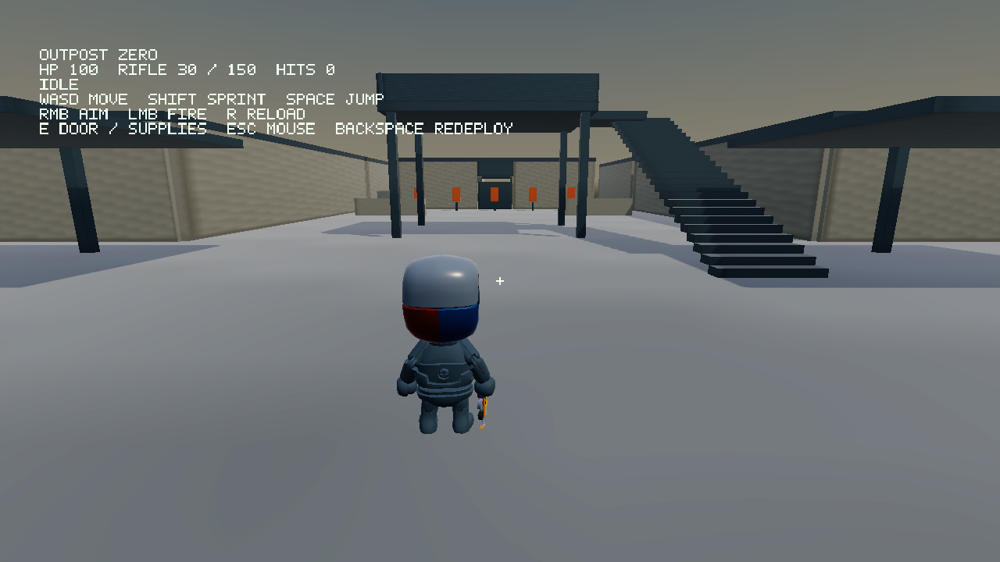

> The high-fidelity visual profile now uses the strict [asset stabilization workflow](AssetStabilization.md). Run `BuildAAAAssets.bat` before building Sandbox. The original base assets remain checked in; the 24 additional models are fetched/cooked locally.

# OUTPOST ZERO — TPS 0–2

Sandbox now starts one persistent third-person facility. Playable stress/demo
scenes and their function-key switches are removed from the executable. Their
regression fixtures remain under `Scripts/Tests/Legacy` and run separately.



## Build and play

Run `GenerateProjects.bat`, open `Build/Generated/PlagC.sln`, build Sandbox and
launch from the repository root. The cooked TPS assets are checked in; a normal
build does not need Python or downloads beyond the pinned engine dependencies.
The native game stays open until the window is closed. FPS is unlocked by default.
Headless, Null and offscreen runs default to 120 frames; `--frames N` overrides it.

| Input | Action |
|---|---|
| WASD | Move relative to camera |
| Mouse | Orbit / look |
| Left Shift | Sprint |
| Space | Jump |
| Right mouse, held | Aim and narrow field of view |
| Left mouse, held | Fire rifle |
| R | Reload |
| E | Nearby control door or supply station |
| Escape | Release / capture mouse |
| Left click while released | Capture mouse |
| Backspace | Redeploy and reset facility |
| F3 | Performance information |
| F4 | Wireframe |
| F11 | Toggle 60 FPS lock |

There are no F5/F6/F7 test scenes. Losing window focus releases the mouse.

## Playable scope

TPS-0 uses the existing engine-owned World, Jolt character, Ozz animation state
machine and PBR import pipeline. The input-independent third-person camera uses a
sphere cast to shorten its arm at obstructions and recover gradually. Its up-axis
stays upright when orbiting. The humanoid is a stylized KayKit mannequin with a
navy body material, nine imported clips and a Kenney rifle attached to its hand.

TPS-1 includes walking, sprinting, jumping, aiming, firing, reloading and death
animations with crossfades. Actual character velocity selects locomotion. The
rifle has a 30-round magazine, 150 reserve rounds, 0.12-second fire interval,
2.1-second reload and 25 damage. A camera ray selects the aim point; a second ray
from the animated rifle muzzle prevents shooting through nearby cover. Five
reactive range targets turn green after four hits. The HUD shows health, ammo,
reload status and hit count. Fall damage and the live electrical floor can kill
the player; automatic redeployment follows after 2.8 seconds. The green supply
station near spawn restores health and reserve ammunition.

TPS-2 contains a connected courtyard, warehouse storage bays, barracks rooms,
workshop, generator hall, watchtower and stairs, control rooms with a sliding door,
a descending tunnel and lower laboratory rooms. Room partitions open onto central
corridors. Static collision uses simple boxes; the sliding door is kinematic.
Imported crates and generators supplement original facility geometry. Materials
use engine-owned sRGB base-colour textures and linear normal/roughness textures
with mipmaps, metallic factors and emissive screens. Lighting combines a sun and
indoor lights. The native renderer draws into RGBA16F, tone maps with manual
exposure, then draws the HUD. An original dusk cubemap supplies sky and reflections.
Spatial synthesized rifle, footstep, mechanism, impact and generator audio uses
OpenAL; the game also runs when audio is disabled or unavailable.

Gameplay lives under `Game/src`; reusable camera and animation socket APIs live in
`PlagC`. AssetScene owns imported graphics resources; the game owns procedural
materials, textures, geometry and audio sources. All are released on redeployment.

## Assets and reproducibility

Source credits, immutable upstream revisions and SHA-256 hashes are in
`Assets/Source/TPS/LICENSES.md` and `manifest.json`. Assets are CC0. Original GLBs
are unchanged; preparation verifies their hashes before building the combined rig.

```sh
python Scripts/PrepareTPSAssets.py
# Use the AssetCooker executable for your platform/configuration:
AssetCooker Bin-Int/TPS/Operative.glb Assets/Cooked/TPS/Operative.plasset
AssetCooker Assets/Source/TPS/Crate.glb Assets/Cooked/TPS/Crate.plasset
AssetCooker Assets/Source/TPS/Generator.glb Assets/Cooked/TPS/Generator.plasset
python Scripts/GenerateTPSSky.py
```

## Validation

`bash Scripts/TestTPS.sh` runs real ECS/Jolt/asset/Ozz gameplay with a recording
renderer. It covers movement, jump, aiming, weapon timing, death, redeployment,
resource cleanup, camera obstruction and facility traversal. This is independent
of the playable application and does not select a hidden scene. Set
`TPS_SANITIZE=1` to instrument game and engine code with ASan/UBSan (vendor
archives remain optimized and uninstrumented).

After a native Linux Dist build, `bash Scripts/TestTPSVisual.sh` exercises the real
OpenGL renderer through Mesa/EGL, captures both sides of the character and an
aiming frame, and resizes an offscreen target. Images are written to `Logs/TPS-*.ppm`.
These checks do not substitute for running the Windows/MSVC build interactively.

## Deliberate boundaries

This is a playable engine integration baseline, not a finished shooter. NPC AI,
factions, navigation and objectives belong to later TPS phases. The five range
targets are stationary, not NPCs. Animation uses whole-body clip crossfades and CPU
skinning; there is no upper-body aim IK or animation layering yet. The rifle aims
at the reticle through raycasts while the imported pose remains a fixed aiming
pose. Audio is synthesized, not recorded weapon audio. HDR uses manual exposure;
there is no bloom or auto-exposure. Shadows use the existing focused shadow setup,
not cascaded sun shadows or shadow maps for every indoor light. The environment
has box-filtered mipmaps, not physically prefiltered GGX irradiance. Level geometry
and the mannequin are intentionally modest in art fidelity.

## Verified in this change

* 28 gameplay checks passed, including aimed target hits and facility traversal.
* ASan/UBSan gameplay run passed with `ASAN_OPTIONS=detect_leaks=0`. LeakSanitizer
  cannot operate under this environment’s process tracing. Vendor archives were
  not instrumented; graphics/audio resource counts were checked explicitly.
* 50 asset/animation/material/audio regressions passed.
* OpenAL null-device gameplay run passed, including five sound sources and full
  audio cleanup (31 checks including the gameplay suite).
* Native Linux OpenGL build, Mesa/EGL captures and target resize passed. Final
  gameplay sources were compiled/linked against the built engine and smoke-tested
  for 30 offscreen frames.
* VS2022 project generation includes Game sources and excludes legacy fixtures.
  Windows/MSVC compilation and interactive Windows input remain unverified here.
